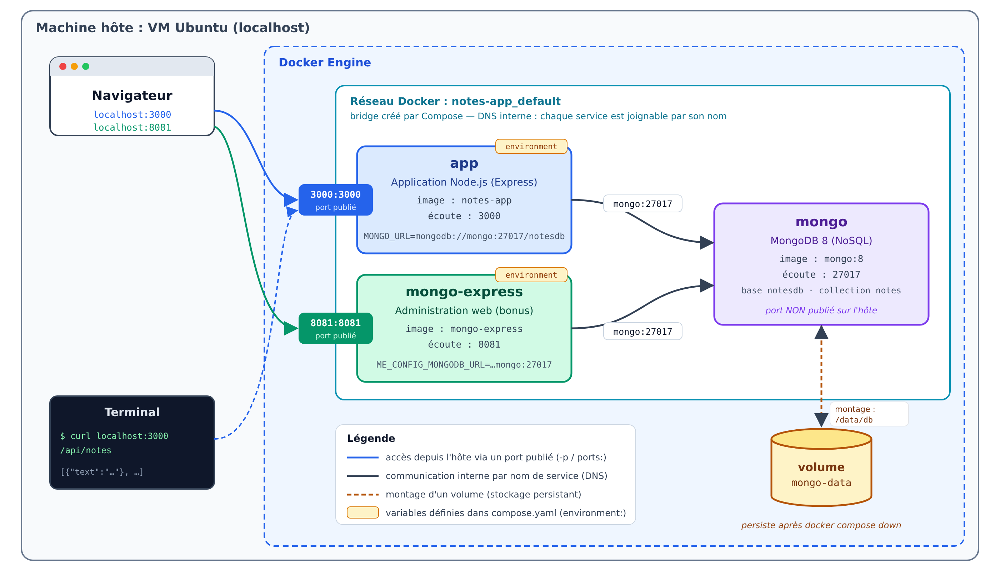

# Exercice — Node.js et MongoDB avec Docker Compose


## Objectif

Conteneuriser une petite application **Node.js** (Express) qui enregistre des notes dans une base **MongoDB**, puis orchestrer l'ensemble avec **Docker Compose**.

---

## 1. L'application fournie

L'application affiche une liste de notes et permet d'en ajouter :

| Action | Route | Opération MongoDB |
|---|---|---|
| Afficher la page des notes | `GET /` | `find()` |
| Ajouter une note (formulaire ou JSON) | `POST /notes` | `create()` |
| Lister les notes au format JSON | `GET /api/notes` | `find()` |

Les notes sont enregistrées dans la base **`notesdb`**, collection **`notes`**.

L'application lit l'adresse de la base dans la variable d'environnement **`MONGO_URL`** :

```javascript
const MONGO_URL = process.env.MONGO_URL || 'mongodb://mongo:27017/notesdb';
```

| Élément de l'URL | Signification |
|---|---|
| `mongodb://` | protocole MongoDB |
| `mongo` | **nom d'hôte** du serveur MongoDB |
| `27017` | port par défaut de MongoDB |
| `notesdb` | nom de la base de données |
### Architecture cible


### Récupération des fichiers

```bash
cd ~
curl -L https://github.com/maymounabensaid/docker-labs/archive/refs/heads/main.tar.gz \
  | tar xz --strip-components=2 docker-labs-main/exercice-node-mongo/sources
mv sources notes-app
cd notes-app
ls -a        # app.js  package.json
```

| Fichier         | Rôle                                                                       |
| --------------- | -------------------------------------------------------------------------- |
| `app.js`        | code de l'application (Express + Mongoose)                                 |
| `package.json`  | dépendances (`express`, `mongoose`) et commande de démarrage (`npm start`) |


Vous allez écrire : **`Dockerfile`** et **`compose.yaml`**.

---

## 2. Le Dockerfile de l'application

Créez le fichier `Dockerfile` en complétant chaque ligne `- - - -` :

```dockerfile
# Utiliser l'image de base officielle Node.js 24, version alpine (node:24-alpine)
- - - -
# Définir le répertoire de travail dans le conteneur (/app)
- - - -
# Copier le fichier package.json
- - - -
# Installer les dépendances (npm install --omit=dev)
- - - -
# Copier le code source de l'application
- - - -
# Exposer le port de l'application (3000)
- - - -
# Définir la commande de démarrage (npm start)
- - - -
```

**Question 1 :** pourquoi copie-t-on `package.json` et installe-t-on les dépendances **avant** de copier `app.js` ?

---

## 3. Le fichier `compose.yaml`

Créez `compose.yaml` avec deux services :

| | service `app` | service `mongo` |
|---|---|---|
| Image | construite depuis `.` → nommée `notes-app` | `mongo:8` (officielle) |
| Variable d'environnement | `MONGO_URL=mongodb://mongo:27017/notesdb` | — |
| Ports | `3000:3000` | aucun (non exposé sur l'hôte) |
| Volume | — | `mongo-data` monté sur `/data/db` |
| Démarrage | après `mongo` | — |
| Redémarrage | `unless-stopped` | `unless-stopped` |

Squelette à compléter :

```yaml
services:
  app:
    - - - -

  mongo:
    - - - -

volumes:
  - - - -
```

Démarrez l'application :

```bash
docker compose up -d
docker compose ps
docker compose logs app        # doit afficher : Connecté à MongoDB
```

**Question 2 :** dans `MONGO_URL`, l'application contacte l'hôte `mongo`. D'où vient ce nom, et qui le traduit en adresse IP ?

**Question 3 :** le port `27017` de MongoDB n'est pas publié sur l'hôte. Comment l'application peut-elle quand même l'utiliser ?

---

## 4. Tests

### 4.1. Depuis le navigateur

Ouvrez http://localhost:3000 et ajoutez deux notes.

### 4.2. Depuis le terminal (API JSON)

```bash
curl -X POST localhost:3000/notes \
  -H "Content-Type: application/json" \
  -d '{"text": "Note ajoutée avec curl"}'

curl localhost:3000/api/notes
```

Rafraîchissez la page : la note ajoutée avec `curl` apparaît.

### 4.3. Directement dans la base

Le client MongoDB `mongosh` est inclus dans l'image `mongo` :

```bash
docker compose exec mongo mongosh notesdb --eval "db.notes.find()"
```

**Question 4 :** dans PostgreSQL (lab 04), la table `tasks` était créée par `init.sql`. Ici, aucun script ne crée la base `notesdb` ni la collection `notes`. À quel moment sont-elles créées ?

### 4.4. Persistance

```bash
docker compose down
docker compose up -d
```

Vos notes sont-elles toujours là ? Recommencez avec `docker compose down -v`.

**Question 5 :** expliquez la différence observée entre les deux commandes.

---

## 5. Bonus : interface d'administration mongo-express

[mongo-express](https://hub.docker.com/_/mongo-express) est une interface web d'administration pour MongoDB (l'équivalent de pgAdmin pour PostgreSQL).

Ajoutez un service `mongo-express` à `compose.yaml` :

- image : `mongo-express` ;
- variables :
  - `ME_CONFIG_MONGODB_URL=mongodb://mongo:27017/`
  - `ME_CONFIG_BASICAUTH_USERNAME=admin`
  - `ME_CONFIG_BASICAUTH_PASSWORD=admin`
- port : `8081:8081` ;
- démarrage après `mongo`.

```bash
docker compose up -d
```

Ouvrez http://localhost:8081 (identifiant `admin` / mot de passe `admin`), ouvrez la base `notesdb` puis la collection `notes`. Ajoutez un document, puis rafraîchissez http://localhost:3000.

---

## 7. Nettoyage

```bash
docker compose down -v
docker rmi notes-app
```
